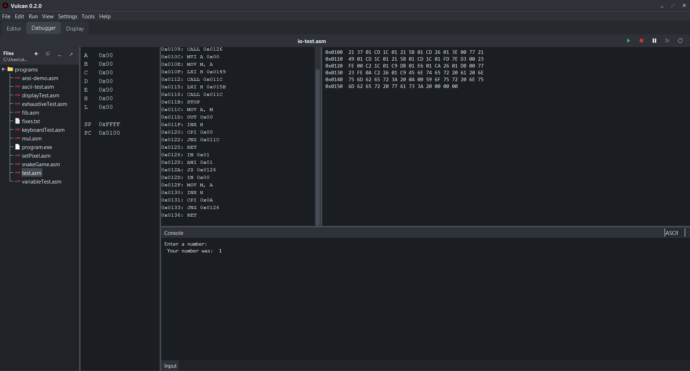

# Vulcan IDE

A C and Intel 8080 assembly IDE built on the [wide Intel 8080](../intel8080) emulator: edit, compile, assemble, link, run and debug in one window, with no external toolchain.


## Features

- Editor with syntax highlighting, completion, search and detachable tabs
- Integrated terminal (`vcc`, `vasm`, `vld`, `vload`, `build`) and `build.run` manifests
- Debugger with registers, memory, disassembly and breakpoints
- Display and keyboard for graphical programs
- Markdown preview, project file manager, light and dark themes
- Local [MCP server](../vulcan-mcp) so AI tools can build and run code




## Install

Needs Java 17+. Build with the `qa` repo cloned next to this one, then launch:

```powershell
..\qa\build.ps1
java -jar "builds\VulcanIDE 0.6.11.jar"
```

The build also refreshes the Desktop shortcut if you already have one.

## Docs

[Using Vulcan](docs/vulcan.md) | [Assembly](docs/asm.md) | [C toolchain](docs/c.md) | [C runtime](docs/c-runtime.md) | [Wide ISA](docs/wide-isa.md) | [Float](docs/register-float.md) | [MCP](docs/mcp.md) | [Performance](docs/performance.md) | [Coding practices](CODING_PRACTICES.md)

Third-party icon licences: `src/VulcanIDE/res/THIRD-PARTY-NOTICES.txt`.
