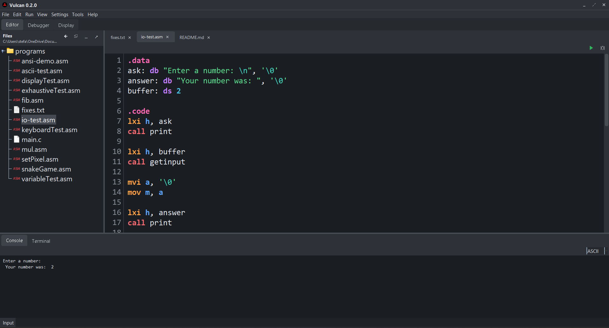
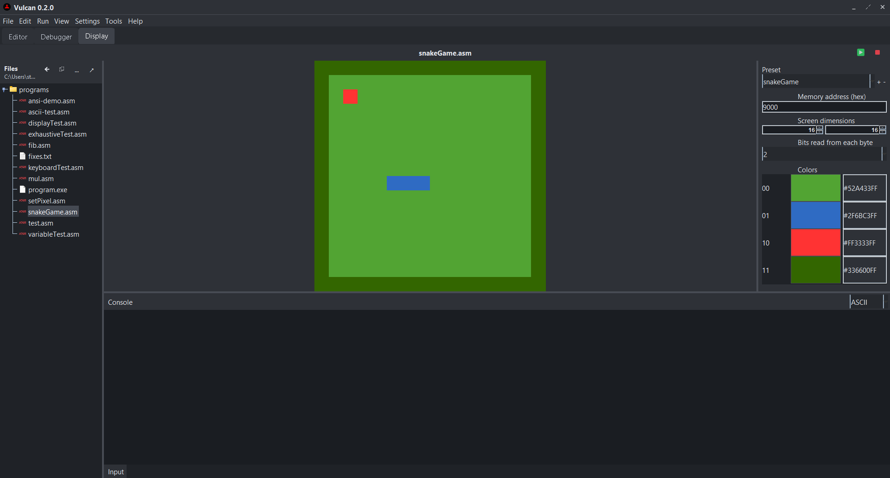

# Vulcan

## Installation

Vulcan requires **Java 17 or newer**. On Windows, install a JDK, open this project folder in PowerShell, and run:

```powershell
.\build.ps1
.\build.ps1 -PackageJar
java -jar ".\builds\latest\VulcanIDE 0.6.11.jar"
```

The normal build compiles sources and runs regression checks without creating a JAR.
`-PackageJar` also writes `builds\latest\VulcanIDE <version>.jar` (replacing older JARs), including
canonical headers, C/assembly runtime, icons and help documents. Launch that
prebuilt JAR to skip IntelliJ's source compilation when you need a quick run; its
menu actions still resolve files relative to the working folder. Editable
standard-library sources live under `src\stdlib\include` and
`src\stdlib\lib`; each library has one provider, while port routines use assembly.
The runnable latest build is kept in `build/latest/`; intermediate compilation
and test output stays ignored. Stable and experimental build channels can be
added alongside `latest` when those release tracks are ready.
Project-wide design, documentation, and implementation guidance is in
[CODING_PRACTICES.md](CODING_PRACTICES.md); public classes and methods carry concise Javadoc, without line comments.

**Vulcan** is a C and Intel 8080 assembly development environment built around a custom Intel 8080 emulator.

It brings editing, compiling, assembling, linking, running, and debugging into one IDE. C and assembly sources can be built together and run on the emulator without relying on external toolchains.

The project started as an Intel 8080 emulator and assembler and has grown into a complete environment for experimenting with low-level programming and understanding how software interacts with a CPU at the instruction level.

## AI tools (MCP)

The local [MCP server](docs/mcp.md) builds and runs C, ASM, build.run manifests and Vulcan executables in one display-capable CPU session. It returns console output and display images, accepts keyboard input, and runs regression checks. Run `..\vulcan-mcp\setup.ps1` once, then add the command from `../vulcan-mcp/client.example.json` to your AI app.

## Features

- C and assembly code editor
- Custom Intel 8080 assembler
- Intel 8080 CPU emulator
- Integrated debugger
- Disassembly and instruction inspection
- Register and memory inspection
- Integrated program display
- Console and I/O support
- Project and file management
- Intel 8080 assembly programs can be written, assembled, executed, and debugged entirely inside Vulcan
- C and assembly toolchain with `vcc`, `vasm`, `vld`, and `vload`
- Four-byte integers, eight-byte longs, software floating arithmetic, arrays, structs, unions, and physical pointers
- Sparse flat 64-bit memory, 32-bit registers, 64-bit pairs and stack, relocatable objects, and segmented executables
- Shared Editor, Debugger, and Display build flow with mixed C/assembly dependencies
- Physical breakpoints, disassembly, and 64-bit memory addresses; see [C reference](docs/c.md), [assembly and CPU reference](docs/asm.md), and [Vulcan guide](docs/vulcan.md)

## Editor

The Vulcan editor provides the main environment for writing and managing C, header, Intel 8080 assembly, and Markdown files.



## Debugger

The integrated debugger provides tools for inspecting program execution, CPU state, memory, registers, and assembly instructions while a program is running.


## Display

Vulcan includes an integrated display for programs that produce graphical output through the emulator's video memory.



## How It Works

Vulcan builds mixed C and assembly sources through one toolchain. C source passes through the compiler first; assembly source goes directly to the assembler:

```text
C Source --------> C Compiler -----+
                                   |
Assembly Source ------------------+--> Assembler + Linker --> Executable
                                                             |
                                                             v
                                                       Intel 8080 Emulator
                                                        /       |       \
                                                  Debugger  Console/I/O  Display
```

Rather than wrapping an existing emulator, the Intel 8080 CPU, assembler, memory system, and development tools are implemented as part of the project.

This makes Vulcan both an IDE and an exploration of how assemblers, processors, debuggers, memory, and development environments work underneath higher-level programming languages.

## Intel 8080

Programs use the **Intel 8080 mnemonics and opcode bytes** with widened Vulcan registers and Vulcan extensions: STOP, counted accumulator rotates (`RLC`/`RRC`/`RAL`/`RAR`), BC-relative byte and 32-bit load/store (`LDBC`/`STBC`, `LDBC32`/`STBC32`), and fused 32-bit BC-relative arithmetic (`ADDBC32`/`SUBBC32`). RST vectors are sixteen bytes apart: RST 0 is 0x00, RST 1 is 0x10, through RST 7 at 0x70. Rebuild older binaries after ISA changes. The [wide ISA reference](docs/wide-isa.md) lists the complete contract. The [VulcanOS example](../vulcanos/os/README.md) starts `kernel_main` through RST 0 and handles Java keyboard input through RST 1.

The emulator handles the CPU state and execution of assembled machine code, including registers, flags, memory, stack operations, control flow, arithmetic, logical operations, and I/O.

## Project Goals

Vulcan is primarily a learning project focused on building low-level development tools from scratch.

The project explores:

- CPU emulation
- Assembly language
- Machine code
- Assembler design
- Memory architecture
- Debugger design
- IDE development
- Graphics and video memory
- Low-level program execution

The long-term goal is to make Vulcan a practical environment where C and Intel 8080 assembly programs can be developed from start to finish without leaving the IDE.
---

*Built from scratch because apparently writing assembly wasn't low-level enough.*

